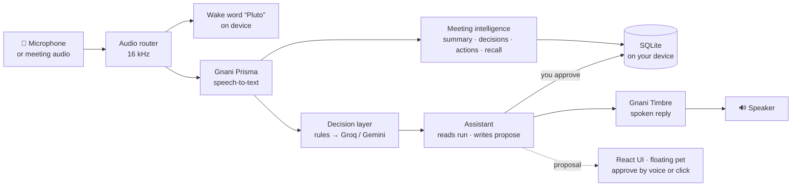

<div align="center">

# 🪐 Pluto Voice

### Talk to your computer the way you talk to people.
**A voice-first desktop assistant for meetings and daily work, built for Hinglish, Tanglish, Kannada-English and plain English.**

[](https://github.com/yokshith09/PLUTO4GNANI/actions/workflows/ci.yml)
[](https://github.com/yokshith09/PLUTO4GNANI/actions/workflows/e2e.yml)


**[⬇️ Download](https://github.com/yokshith09/PLUTO4GNANI/releases)** · **[✨ Features](#-features)** · **[🎙️ Try saying](#️-try-saying)** · **[🔒 Privacy](#-privacy-and-safety)** · **[🛠️ Build it](#️-build-from-source)**

Built for the **Gnani AI Great Indian AI Internship Challenge 2026** on Gnani **Prisma** (speech-to-text) and **Timbre** (text-to-speech).

</div>

---

## 💡 The idea

| The problem | What Pluto does |
|---|---|
| 🗣️ Indian teams switch languages mid-sentence, so decisions, owners and deadlines never get written down. | Understands code-mixed speech and turns every meeting into **decisions, action items and a summary**. |
| 🔎 "Who promised what, by when?" means replaying an hour of recording. | **Ask by voice or search** and get the answer with the exact quote. |
| ⌨️ Adding a task or reminder means switching windows and typing. | **Say it.** Hold a key, or just say "Pluto". |

One local app, one voice runtime, one database on your machine. **Nothing is changed without your approval.**

---

## ✨ Features

### 🎙️ Voice Assistant

| | |
|---|---|
| **Push-to-talk** | Hold a key anywhere in Windows or macOS and speak. Release to send. |
| **Hands-free** | Press once, talk, and it ends by itself after a short pause. |
| **Always-on "Pluto"** | Say "Pluto" and your command. The wake word is detected on your computer; nothing is sent until you say it. |
| **Talks like a call** | Pluto asks when something is missing ("When should I remind you?"), your answer finishes the command, and it keeps listening for the reply. Esc cancels. |
| **Dictation** | Speak and Pluto types the words into any app, such as Notepad, Gmail or Slack. |
| **Tasks and reminders** | Create, finish, move, list and delete, in the language you speak. |
| **Approval gate** | Reading is instant. Anything that changes data waits for "haan" or a click. |
| **Spoken replies** | Answers come back in your language through Gnani Timbre. Talk over them to cut in. |
| **Floating pet** | A small always-on-top companion shows the state, the proposal to approve and meeting prompts. |

### 📋 Meeting Assistant

| | |
|---|---|
| **Record or import** | Record with a consent tick (with the computer's sound too, so calls are captured) or import a file. |
| **Google Meet auto mode** | The pet notices a Meet call, offers to record, and writes the results afterwards. |
| **Accurate transcript** | Speaker-labelled, searchable, with long recordings chunked and retried. |
| **Summary tab** | Summary, decisions and action items in one place, saved to the meeting's notes the moment they are written. Regenerate whenever you like. |
| **Find in transcript** | One search box finds meetings, people and what was said, and jumps to the line. |
| **Recap** | A spoken recap you can play or export as an mp3. |
| **Commitments** | A running "who owes what" across every meeting. |
| **Recall** | Ask "Priya ne login fix kab tak bola tha?" and hear the answer with its source quote. |

---

## 🎙️ Try saying

| You say | Pluto does |
|---|---|
| "Kal tak budget report bhejna hai" | Proposes a task due tomorrow. Say "haan" to approve. |
| "Kal shaam 5 baje DBMS submit karne ka reminder lagao" | Proposes a reminder for 5 PM tomorrow. |
| "Remind me to call Ravi" → *"When?"* → "At 6 pm" | Asks, takes your answer, finishes the command. |
| "Move the report task to the 11th" | Changes the due date. |
| "What's overdue?" / "Aaj ke kaam batao" | Reads your tasks aloud. |
| "Meetings kholo" / "Go to settings" | Opens the page. |
| "Pluto, add a task to call Ravi" | Always-on: no key needed. |
| "Pluto, haan" | Approves the waiting card hands-free. |

## ⌨️ Shortcuts

Every shortcut can be changed in **Settings → Voice & privacy**.

| Action | Default | What it does |
|---|---|---|
| **Hold to talk** | `Ctrl` `Shift` `Space` | Listens while held. |
| **Hands-free** | `Ctrl` `Alt` `Space` | Starts listening; ends after a 1.2 s pause. |
| **Dictation** | `Ctrl` `Alt` `Shift` `Space` | Types what you say into the focused app. |
| **Cancel** | `Esc` | Stops listening or speaking. |

> On macOS the same actions are available; pick the keys that suit you in Settings.

---

## 🧭 How it works



| Layer | Technology |
|---|---|
| Desktop shell | Tauri v2, Rust |
| UI | React 18, TypeScript, Vite, Tailwind, Radix UI |
| Speech | Gnani Prisma (Realtime, Batch, REST) and Timbre |
| Wake word | Rustpotter on device, taught with your own voice |
| Reasoning | Groq for fast voice commands, Gemini for meetings; each is the other's fallback |
| System audio | WASAPI loopback (Windows), ScreenCaptureKit (macOS) |
| Storage | SQLite with full-text search on your device; API keys in the OS keychain |

<details>
<summary><b>Rust workspace</b></summary>

| Crate | Responsibility |
|---|---|
| `pluto-core` | Tasks, reminders, notes, focus, meetings, settings, SQLite |
| `pluto-contracts` | Shared types and commands (exported to TypeScript with ts-rs) |
| `pluto-gnani` | Gnani clients: Realtime, Batch, REST and Timbre streaming |
| `pluto-voice` | Audio routing, voice runtime, wake word, assistant and approval gate |
| `pluto-intel` | LLM router, intent decisions, meeting extraction, recap and recall |
| `pluto-loopback` | Computer's sound capture for meetings (Windows and macOS) |
| `pluto-mic` | Native microphone capture (beta) |
| `src-tauri` | The desktop shell: commands, events, hotkeys, tray, pet |

</details>

---

## 🔒 Privacy and safety

| Promise | How it is kept |
|---|---|
| **Nothing is sent until you allow it** | **Cloud voice** is off by default. One switch is checked before every network call, and a test proves zero requests leave. |
| **No change without approval** | Every write is a 30-second proposal; each one can run at most once. |
| **Wake word stays local** | Listening for "Pluto" sends nothing. Only the command after it goes out. |
| **See every outbound call** | A privacy log lists each request. |
| **Your data stays on your device** | Meetings, tasks and notes live in a local SQLite file. |
| **Keys are never in files** | They are stored in the OS keychain. |
| **Recording needs consent** | A tick is required every time. |

Safety test results: [`docs/results/safety.md`](docs/results/safety.md)

---

## ⬇️ Download

Get the latest installer from the **[Releases page](https://github.com/yokshith09/PLUTO4GNANI/releases)**.

| Platform | File |
|---|---|
| 🪟 Windows 10 / 11 | `Pluto_x64_en-US.msi` or `Pluto_x64-setup.exe` |
| 🍎 macOS (Apple silicon) | `Pluto_aarch64.dmg` |

> Installers are **not code-signed** yet. On Windows choose **More info → Run anyway** in SmartScreen. On macOS right-click the app and choose **Open** the first time.

### First run
1. Open **Settings → Voice & privacy**.
2. Paste your Gnani, Groq and Gemini keys. They go to the OS keychain.
3. Turn on **Cloud voice**.
4. Hold the push-to-talk key and speak.
5. Optional: **Teach Pluto your voice** (say "Pluto" eight times), then switch on **Always-on listening**.

---

## 🛠️ Build from source

**You need:** Node.js 22, pnpm 10, Rust (the version is pinned in `rust-toolchain.toml`), and on Windows the WebView2 runtime.

```bash
git clone https://github.com/yokshith09/PLUTO4GNANI.git
cd PLUTO4GNANI
pnpm install
pnpm tauri dev
```

Run the checks:

```bash
cargo test --workspace      # Rust: unit, contract and state-machine tests
pnpm test                   # UI tests
pnpm typecheck && pnpm lint
pnpm e2e                    # end-to-end flows
```

Releases are built by GitHub Actions: changing the version on `main` produces a draft release with the Windows and macOS installers.

---

## 📁 Project layout

```
crates/       Rust workspace: core, contracts, gnani, voice, intel, loopback, mic
src-tauri/    Tauri shell: commands, hotkeys, tray, pet
src/          React UI (features/, pet/, audio/, ipc/)
e2e/          end-to-end tests
test-data/    scripted code-mixed audio and fixtures
docs/         product, architecture, contracts, results
```

| Document | Covers |
|---|---|
| [`docs/common/PRD.md`](docs/common/PRD.md) | Problem, users, requirements |
| [`docs/common/ARCHITECTURE.md`](docs/common/ARCHITECTURE.md) | Components, audio path, LLM router, privacy |
| [`docs/common/API_CONTRACTS.md`](docs/common/API_CONTRACTS.md) | APIs, types, commands, events |
| [`docs/common/TESTING_STRATEGY.md`](docs/common/TESTING_STRATEGY.md) | Test plan and gates |
| [`docs/results/`](docs/results/) | Live checks, safety, wake word, system audio |

---

## 👥 Team

| | GitHub | Focus |
|---|---|---|
| Yokshith | [yokshith09](https://github.com/yokshith09) | Meeting intelligence, recording and system audio, Meetings UI, floating pet, settings |
| Akhil | [Duggineniakhil](https://github.com/Duggineniakhil) | Gnani clients, voice runtime, wake word, assistant and approval gate |
