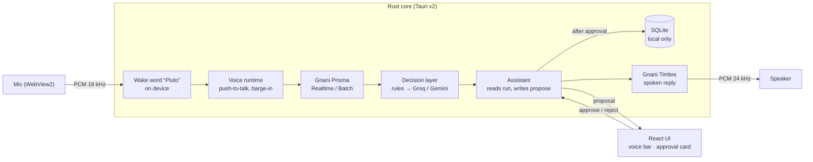

<div align="center">

# Pluto Voice

**A voice-first desktop assistant for meetings and personal productivity, built for code-mixed Indian speech.**

Speak in Hinglish, Tanglish, Kannada-English or English. Pluto turns meetings into decisions and tasks, and runs your day by voice: hold a key, or just say “Pluto”.

[](https://github.com/yokshith09/PLUTO4GNANI/actions/workflows/ci.yml)
[](https://github.com/yokshith09/PLUTO4GNANI/actions/workflows/e2e.yml)


[](Cargo.toml)

Built for the **Gnani AI Great Indian AI Internship Challenge 2026** on Gnani **Prisma** (speech-to-text) and **Timbre** (text-to-speech).

</div>

---

## Contents
- [Why Pluto Voice](#why-pluto-voice)
- [Features](#features)
- [Try saying](#try-saying)
- [How it works](#how-it-works)
- [Privacy and safety](#privacy-and-safety)
- [Getting started](#getting-started)
- [Testing](#testing)
- [Project structure](#project-structure)
- [Documentation](#documentation)
- [Team](#team)
- [License](#license)

## Why Pluto Voice
- **Meeting outcomes get lost.** Indian teams talk in mixed languages, and decisions, owners and deadlines are rarely written down.
- **Past meetings can't be questioned.** Answering "who promised what, by when?" means replaying recordings.
- **Productivity tools are English-first and keyboard-first.** Adding a task or a reminder means switching windows and typing.

Pluto Voice brings both together in one local app: one voice runtime and one local database, with nothing written without your approval.

## Features

### Voice Assistant
- **Push-to-talk from anywhere:** a global hotkey (default `Ctrl+Shift+Space`, configurable) or the mic button in the voice bar. "Listening" shows at once, while the connection opens in the background.
- **Always-on, hands-free:** say **“Pluto”**, then your command.
  - The wake word is detected on your computer, using about 2% of one CPU core. Nothing is sent until you say “Pluto”.
  - Teach it your voice once in Settings by saying “Pluto” eight times.
  - It works while a proposal waits for your answer (“Pluto, haan”), and over a reply, which it stops.
- **Code-mixed understanding:** Gnani Prisma Realtime transcribes, then rules and an LLM (Groq, with Gemini as fallback) choose the action.
- **Tasks and reminders:**
  - Create and complete tasks, and change due dates.
  - Set reminders ("kal shaam 5 baje…") and list them.
  - Notes and focus sessions by voice come next (T-508).
- **Navigation:** "meetings kholo" or "go to settings" switches the page.
- **Spoken replies** in the language you used, through Gnani Timbre. You can talk over a reply to cut it off (barge-in).
- **Approval by voice or click:** every change waits on a card; say “haan” or “nahi”, or click.
- **Context:** the last six turns are kept, so "usse Friday kar do" (move that one to Friday) refers to the task you just discussed.

### Meeting Assistant
- **Record or import** a meeting. Recording needs a consent checkbox, can be paused and resumed, and recovers after a crash.
- **Speaker-labelled transcripts** of long recordings through Gnani Prisma Batch, with chunking and retries.
- **Extraction:** decisions, action items, owners, deadlines, questions and risks, each linked to the exact quote.
- **Review, then apply:** approved action items become tasks.
- **Recaps** and a **commitment tracker** ("who owes what").
- **Recall by voice:** ask about a past meeting and hear a grounded answer with its source quote; open commitments are read out too.

> Live status of every feature is on the task board in [`PROJECT_ROADMAP.md`](PROJECT_ROADMAP.md).

## Try saying
| You say | Pluto does |
|---|---|
| "Kal tak budget report bhejna hai" | Proposes a task due tomorrow. Say "haan", or click **Approve** |
| "Kal shaam 5 baje DBMS submit karne ka reminder lagao" | Proposes a reminder for 5 PM tomorrow |
| "Add a meeting with Ravi tomorrow at 6 pm" | Proposes a task for tomorrow, with a reminder at 6 PM |
| "Aaj ke kaam batao" / "What's overdue?" | Reads your tasks aloud |
| "Usse Friday kar do" | Moves the task you just talked about to Friday |
| "Meetings kholo" / "Go to settings" | Opens that page |
| "Pluto, add a task to call Ravi tomorrow" | With always-on: no key needed |
| "Pluto, haan" | Approves the waiting card hands-free |
| "Priya ne login fix kab tak bola tha?" | Finds the quote in your meetings |

## How it works



| Layer | Technology |
|---|---|
| Desktop shell | Tauri v2, Rust 1.97 |
| UI | React 18, TypeScript, Vite, Tailwind 4, Radix UI |
| Audio | Mic capture and playback in WebView2 (AudioWorklet, Web Audio); everything else in Rust |
| Speech | Gnani Prisma v3.0 (Realtime, Batch, REST) and Timbre v3.0 |
| Wake word | Rustpotter, on device, taught with the user's own voice |
| Reasoning | Groq for voice commands, Gemini for meetings; each is the other's fallback |
| Storage | SQLite (rusqlite, FTS5) on the device; API keys in the OS keychain |
| Tests | cargo test, wiremock, Vitest and Testing Library, end-to-end on Windows CI |

**Rust workspace**

| Crate | Responsibility |
|---|---|
| `pluto-core` | Tasks, reminders, notes, focus, meetings, settings, SQLite |
| `pluto-contracts` | Shared types, traits, commands and errors (exported to TypeScript with ts-rs) |
| `pluto-gnani` | Gnani clients: Realtime WebSocket, Batch, REST and Timbre streaming |
| `pluto-voice` | Audio routing, voice runtime state machine, assistant and approval gate, wake word, Cloud voice gate, meeting jobs |
| `pluto-intel` | LLM router, intent decisions, meeting extraction, recap and recall |
| `src-tauri` | The desktop shell: commands, events, hotkeys, tray |

## Privacy and safety
- **No write without approval.** Anything that changes your data becomes a proposal that waits 30 seconds for a "haan" or a click. A single conditional database update lets each proposal run at most once.
- **Cloud voice is opt-in.** When it is off, nothing leaves the device: one switch is checked right before every network call (Gnani, Gemini, Groq), and a test proves zero requests go out.
- **The wake word stays on device.** Listening for “Pluto” sends nothing; only the command after it goes to Gnani, like push-to-talk.
- **Local data.** Meetings, tasks and notes stay in a SQLite file on your machine.
- **Keys in the OS keychain**, never in files or logs.
- **Recording needs consent**, given explicitly every time.
- **Tested:** no write without approval, keys never in logs, the database or exports, every outbound call logged, and cloud off meaning zero requests ([safety results](docs/results/safety.md)).

## Getting started

### Prerequisites
- Windows 10 or 11 with WebView2 (preinstalled on Windows 11)
- [Node.js 22](https://nodejs.org) and [pnpm 10](https://pnpm.io)
- [Rust](https://rustup.rs). The toolchain version is pinned in `rust-toolchain.toml`.
- API keys for [Gnani](https://gnani.ai), [Groq](https://console.groq.com) and [Gemini](https://aistudio.google.com)

### Install and run
```bash
git clone https://github.com/yokshith09/PLUTO4GNANI.git
cd PLUTO4GNANI
pnpm install
pnpm tauri dev
```

### Add your keys
1. In the app, open **Settings → Voice & privacy**.
2. Paste the Gnani, Groq and Gemini keys. They are stored in the OS keychain.
3. Turn on **Cloud voice**.
4. Hold the push-to-talk key and speak.
5. Optional: **Teach Pluto your voice**, then turn on **Always-on listening** and just say “Pluto”.

The command-line examples and live tests read keys from a git-ignored `.env` instead:
```bash
cp .env.example .env
```

### Release builds
Windows installers are built by the [Release build](.github/workflows/release.yml) workflow on GitHub. It runs on a `v*` tag, or when the version number changes on `main`.

## Testing
```bash
cargo test --workspace        # Rust: unit, contract (wiremock) and state-machine tests
pnpm test                     # UI: Vitest and Testing Library
pnpm typecheck && pnpm lint
pnpm e2e                      # end-to-end flows
```

**Live checks** against the real services are kept in [`docs/results/`](docs/results/):
- [Gnani live checks](docs/results/gnani-live-checks.md)
- [Mic check](docs/results/mic-check.md)
- [LLM check](docs/results/d2-llm-check.md)
- [Safety checks](docs/results/safety.md)
- [Wake word](docs/results/wake-word.md)

## Project structure
```
crates/            Rust workspace: core, contracts, gnani, voice, intel
src-tauri/         Tauri shell: commands, events, hotkeys, tray
src/               React UI (features/, audio/, ipc/)
e2e/               end-to-end tests
test-data/         scripted code-mixed audio, ground truth, fixtures
docs/              product, architecture, contracts, per-developer specs, results
```

## Documentation
| Document | What it covers |
|---|---|
| [`PROJECT_ROADMAP.md`](PROJECT_ROADMAP.md) | Milestones and the task board (single source for status) |
| [`docs/common/PRD.md`](docs/common/PRD.md) | Problem, users, requirements, metrics and non-goals |
| [`docs/common/ARCHITECTURE.md`](docs/common/ARCHITECTURE.md) | Components, audio path, Gnani integration, LLM router and privacy |
| [`docs/common/API_CONTRACTS.md`](docs/common/API_CONTRACTS.md) | External APIs, types, commands, events and errors |
| [`docs/common/DATA_SCHEMA.md`](docs/common/DATA_SCHEMA.md) | Tables and migrations |
| [`docs/common/UI_UX_SPEC.md`](docs/common/UI_UX_SPEC.md) | Screens and states |
| [`docs/common/TESTING_STRATEGY.md`](docs/common/TESTING_STRATEGY.md) | Test plan, audio sets and the end-to-end gate |
| [`docs/common/WORKING_AGREEMENT.md`](docs/common/WORKING_AGREEMENT.md) | Ownership, branches, pull requests and contract changes |
| [`docs/dev1/START_HERE.md`](docs/dev1/START_HERE.md) · [`docs/dev2/START_HERE.md`](docs/dev2/START_HERE.md) | Onboarding for each developer |

## Team
| | GitHub | Focus |
|---|---|---|
| Developer 1 | [Duggineniakhil](https://github.com/Duggineniakhil) | Platform, audio, Gnani clients, voice runtime, assistant and approval gate, Windows build |
| Developer 2 | [yokshith09](https://github.com/yokshith09) | UI, LLM router and decisions, meeting intelligence, voice UX |

The personal productivity base (tasks, reminders, notes, focus and projects) is ported from the owner's earlier Pluto app; see [`docs/common/PORTING_FROM_PLUTO.md`](docs/common/PORTING_FROM_PLUTO.md). The voice, meeting and LLM layers are new.

## License
[MIT](Cargo.toml)
